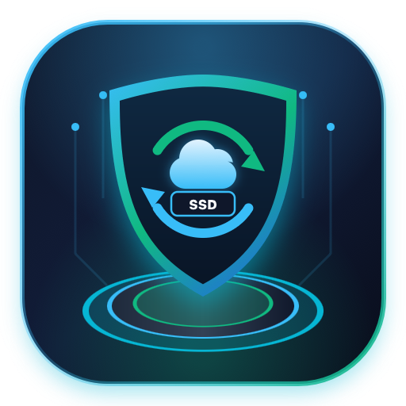

<div align="center">



# CasaOS Backup Manager Pro

**Self-Contained Backup, Disaster Recovery & Cloud Sync Engine for CasaOS, Portainer & Docker Homelabs**

[](https://github.com/boystyle2010/casaos-backup-manager/actions/workflows/auto-update-base.yml)
[](https://github.com/boystyle2010/casaos-backup-manager/pkgs/container/casaos-backup-manager)
[](https://hub.docker.com/_/python)
[](https://rclone.org/)
[](https://www.openssl.org/)
[](./CHANGELOG.md)

</div>

---

## Overview

**CasaOS Backup Manager Pro** is a lightweight, self-contained container backup and disaster recovery solution purpose-built for **CasaOS**, **Portainer**, and **Linux Docker Homelabs**. Engineered with an **Ultra Glassmorphism & Bento Telemetry UI**, it delivers a native, zero-lag experience on both desktop browsers and iOS Safari.

It automatically discovers running and stopped containers, extracts full container specifications (`container_spec.json` including networks, environment variables, port bindings, and volumes), compresses persistent `AppData` directories safely while containers are live, verifies integrity via `SHA-256`, optionally encrypts archives with `AES-256-CBC`, and syncs snapshots to your cloud storage via **Rclone**.

---

## Key Features

- **Bento Telemetry Dashboard**: Real-time monitoring of active containers, snapshot counts, cloud sync status, and system SSD usage (`AppData` vs. `Backups`).
- **Smart SSD Disk Guard**: Configurable per-container size limits (e.g., skip containers exceeding `10 GB`) and minimum free SSD space guards (e.g., abort and clean up temporary files if free space drops below `5 GB`).
- **Full Container Recreation**: Restores not only persistent volume data but can also recreate missing Docker networks and redeploy containers from scratch on a fresh OS installation.
- **Dedicated Home Assistant Schedule**: Separate cron scheduling for Home Assistant with automatic pre-backup cleanup of `.sync-conflict` files, `.corrupt` databases, and old logs.
- **End-to-End AES-256 Encryption**: Password-protected encryption (`PBKDF2` + `AES-256-CBC`) before uploading snapshots to Google Drive, OneDrive, S3, or WebDAV.
- **1-Tap Cloud Recovery Key (`CBMKEY`)**: Export your entire Rclone configuration and app settings into a single Base64 recovery string for instant setup on new servers.
- **Automated Base Updates**: GitHub Actions bot checks daily at **06:00 AM (America/Denver)** for newer Python base images, Rclone releases, and PyPI dependencies, automatically testing, updating `CHANGELOG.md`, and publishing fresh Docker images to GHCR.
- **Bilingual UI**: Instant toggle between **English (EN)** and **Vietnamese (VI)**, plus Dark/Light theme support.

---

## Quick Installation

You can deploy **CasaOS Backup Manager Pro** directly via **CasaOS Custom Install (Import Docker Compose)**, **Portainer Stacks**, or standard **Docker Compose CLI**.

### Option 1: Docker Compose / CasaOS / Portainer Stack (Recommended)

Use the pre-built image from GitHub Container Registry (`ghcr.io`):

```yaml
name: casaos-backup-manager
services:
  backup-manager:
    image: ghcr.io/boystyle2010/casaos-backup-manager:latest
    container_name: casaos-backup-manager
    hostname: casaos-backup-manager
    restart: unless-stopped
    cpu_shares: 90
    environment:
      BACKUP_ROOT: /DATA/Backups
      TZ: America/Denver
    ports:
      - target: 8095
        published: "8095"
        protocol: tcp
    volumes:
      - type: bind
        source: /var/run/docker.sock
        target: /var/run/docker.sock
      - type: bind
        source: /DATA
        target: /DATA
      - type: bind
        source: /var/lib/docker/volumes
        target: /var/lib/docker/volumes
      - type: bind
        source: /DATA/AppData/casaos-backup-manager/config
        target: /root/.config/rclone
    labels:
      icon: https://raw.githubusercontent.com/boystyle2010/casaos-backup-manager/main/icon.png
    x-casaos:
      author: boystyle2010
      category: Utilities
      hostname: ""
      icon: https://raw.githubusercontent.com/boystyle2010/casaos-backup-manager/main/icon.png
      index: /
      port_map: "8095"
      scheme: http
      title:
        en: Backup Manager
        en_us: Backup Manager

networks:
  default:
    name: casaos-backup-manager_default
```

### Option 2: Deploy via CLI

```bash
mkdir -p /DATA/AppData/casaos-backup-manager/config
cd /DATA/AppData/casaos-backup-manager
curl -fsSL https://raw.githubusercontent.com/boystyle2010/casaos-backup-manager/main/docker-compose.yml -o docker-compose.yml
docker compose up -d
```

Once started, open your browser at:
```text
http://<YOUR_SERVER_IP>:8095
```

---

## How to Configure Rclone (Cloud Storage)

Each user configures their own private cloud storage credentials locally. Your `rclone.conf` is stored strictly on your host at `/DATA/AppData/casaos-backup-manager/config/rclone.conf` and is never shared.

### Method A: Paste `rclone.conf` Directly in the Web UI (Easiest)

1. Generate your `rclone.conf` on any computer with a web browser by running:
   ```bash
   rclone config
   ```
   *(Follow the interactive prompts to authenticate Google Drive, OneDrive, Dropbox, S3, etc., then run `rclone config file` to view the generated config content).*
2. Open **CasaOS Backup Manager** (`http://<SERVER_IP>:8095`) -> Go to the **Settings** tab.
3. Under **Cloud Storage (Rclone)**, click **Edit rclone.conf**.
4. Paste your configuration block into the editor, for example:
   ```ini
   [gdrive]
   type = drive
   scope = drive
   token = {"access_token":"...","token_type":"Bearer","refresh_token":"...","expiry":"..."}
   ```
5. Click **Save rclone.conf**.
6. Set **Remote Destination Path** to your remote name and folder (e.g., `gdrive:CasaOS_Backups`) and click **Save Changes**.

### Method B: Generate Config Inside the Container via CLI

If you prefer configuring via SSH on your server:

```bash
docker exec -it casaos-backup-manager rclone config
```

### Method C: 1-Tap Recovery Key (`CBMKEY`)

1. Once your cloud connection and backup policies are configured, go to **Settings** -> **Cloud Recovery Key** and click **Copy Key**.
2. Save the `CBMKEY:ey...` string in a secure note or password manager.
3. On any new server installation, simply click **Paste Key**, insert your `CBMKEY`, and click **Restore** to recover your cloud connection and schedules in one tap.

---

## Upgrading the Container

Because our GitHub Actions workflow automatically checks and builds updated base images daily:

- **In CasaOS:** Click the three dots (`...`) on the **Backup Manager** app icon and select **Check then update**.
- **In Portainer:** Open the `casaos-backup-manager` container -> Click **Recreate** -> Enable **Re-pull image** -> Click **Recreate**.
- **Via CLI:**
  ```bash
  cd /DATA/AppData/casaos-backup-manager
  docker compose pull && docker compose up -d
  ```

---

## Project Structure

```text
casaos-backup-manager/
├── .github/workflows/
│   └── auto-update-base.yml  # Daily CI/CD bot: updates bases, CHANGELOG.md & GHCR image
├── app/
│   ├── main.py               # FastAPI Backend (Docker SDK, Rclone engine, SHA-256, Cron)
│   └── templates/
│       └── index.html        # Glassmorphic Bento UI (TailwindCSS + Alpine.js, EN/VI)
├── icon.png                  # 3D Transparent PNG Icon (512x512)
├── Dockerfile                # Container build instructions
├── requirements.txt          # Pinned Python dependencies
├── docker-compose.yml        # Ready-to-use deployment stack
├── CHANGELOG.md              # Automated release & dependency history
└── README.md                 # Project documentation
```